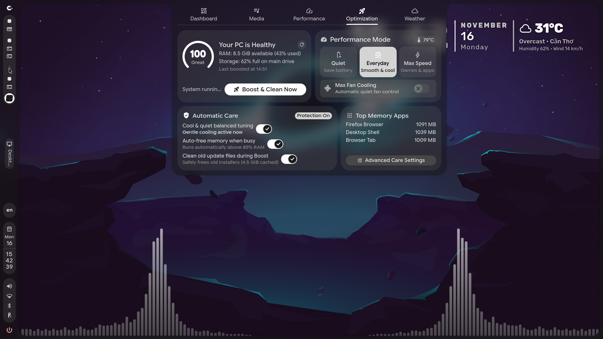
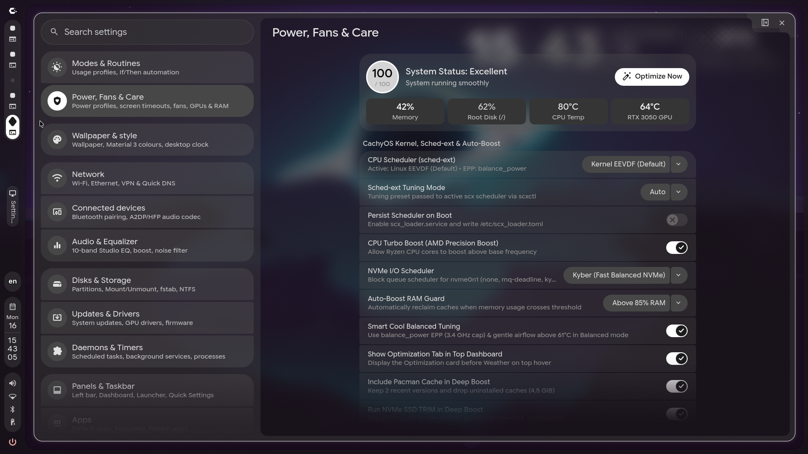
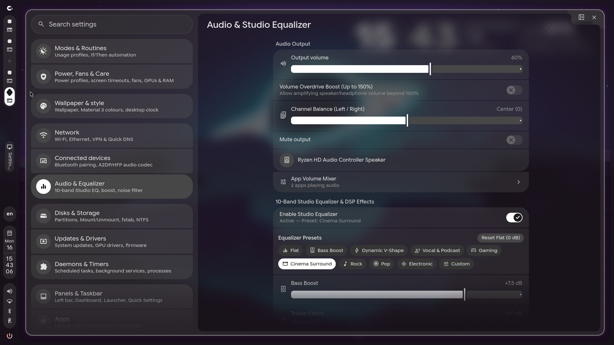

<div align="center">


# Caelestia × Meow Remake

**A Material 3 Wayland Desktop Environment (`Hyprland` + `Quickshell`) enhanced with One-Click Smart Optimization, Adaptive Thermal & Fan Control, CachyOS `sched-ext`, 10-Band PipeWire Studio Equalizer, and a Unified Nexus Control Center.**

[](https://hyprland.org/)
[](https://quickshell.outfoxxed.me/)
[](https://cachyos.org/)
[-FF79C6?style=for-the-badge&logo=github&logoColor=white)](https://github.com/NCH2024)

</div>

---

## Showcase

### Desktop & Top-Hover Smart Optimization

<table>
  <tr>
    <td width="50%">
      
      <p align="center"><sub><b>Clean Desktop & Audio Visualizer</b> — Dynamic Material 3 theming, clock/weather widget, and persistent side taskbar.</sub></p>
    </td>
    <td width="50%">
      
      <p align="center"><sub><b>Top-Hover Optimization Tab</b> — Placed directly before Weather: 100-point Health ring, 1-tap Quiet / Everyday / Max Speed presets, Max Fan Cooling, and Automatic Care.</sub></p>
    </td>
  </tr>
</table>

### Nexus Control Center (`Mod + ,` / Sidebar Settings)

<table>
  <tr>
    <td width="33.3%">
      
      <p align="center"><sub><b>Power, Fans & Care</b> — Live CachyOS <code>scx_loader</code> scheduler, CPU Turbo, NVMe I/O queue, Auto-RAM Guard, and Dell PWM fan curves.</sub></p>
    </td>
    <td width="33.3%">
      
      <p align="center"><sub><b>Audio & Studio Equalizer</b> — PipeWire 10-band DSP filter chain managed cleanly via <code>caelestia-eq.service</code> with 10 instant presets.</sub></p>
    </td>
    <td width="33.3%">
      
      <p align="center"><sub><b>About (Caelestia × Meow)</b> — Co-branded hero emblem with adaptive Material 3 colorization and system hardware readout.</sub></p>
    </td>
  </tr>
</table>

---

## What Makes This Remake Different?

| Feature | What Changed vs Stock |
| :--- | :--- |
| **Smart Optimization Tab** | Added an everyday-friendly **Optimization** tab to the top-hover Dashboard drawer (right before **Weather**), with zero confusing kernel jargon on the surface while driving real sysfs/D-Bus controls underneath. |
| **Anti-Heat Balanced Tuning** | Fixes hot laptop idle behavior (`4.0+ GHz` spikes & `0 RPM` BIOS fans) using `balance_power` EPP + `80%` frequency cap and an adaptive whisper-quiet fan hysteresis (`≥ 61°C` gentle airflow, `≤ 53°C` silent auto). |
| **Optimus dGPU Power Saving** | Automatically configures `AQ_DRM_DEVICES` for iGPU-first compositing (`amdgpu`/`i915`/`xe`) and skips `nvidia-smi` polling while the dGPU is sleeping in D3cold. |
| **CachyOS `sched-ext` Control** | Built-in `scxctl` D-Bus switching between Linux **EEVDF**, **`scx_lavd`**, **`scx_bpfland`**, **`scx_cosmos`**, and **`scx_rusty`** with optional boot persistence via `/etc/scx_loader.toml`. |
| **Deep System Boost** | Real staged cleanup (`caelestia-optimize`): drops caches + compacts fragmented RAM, removes orphaned `pacman` `download-*` folders & old `paccache` versions, vacuums `journald`, resets failed units, and runs `fstrim` — reporting exact MiB reclaimed. |
| **Studio 10-Band Equalizer** | Rewritten as a resilient user `systemd-run` PipeWire unit (`caelestia-eq.service`) so EQ presets (`Cinema Surround`, `Bass Boost`, `Rock`, `Gaming`, custom bands) survive sink switches reliably. |
| **Single Source of Truth** | Top Dashboard, Quick Settings tiles, Top Bar care button, Modes & Routines, and Nexus Settings share unified state in `OptimizerService.qml` and `ExtraConfig.qml`. |
| **100% English UI & Seamless Auth** | Clean, unified English Material 3 interface with non-blocking `pkexec` progress bars (`TaskRunner.qml`), expandable logs on demand, matching SDDM login theme, and hang-free Hyprland logout (`hyprctl dispatch exit`). |

---

## Prerequisites (Arch Linux / CachyOS)

Install the required packages before running `./install.sh`:

```bash
# Core Hyprland + Quickshell + Caelestia stack
sudo pacman -S --needed \
  hyprland quickshell-git caelestia-cli \
  power-profiles-daemon pipewire wireplumber \
  ananicy-cpp pacman-contrib bluez networkmanager \
  sddm qt6-5compat grim

# Optional: CachyOS sched-ext CPU schedulers (LAVD, Bpfland, Cosmos, Rusty)
sudo pacman -S --needed scx-scheds scx-tools
```

> **Arch / EndeavourOS Users:** If `quickshell-git` or `caelestia-cli` is not in your standard repositories, install them via AUR (`paru -S quickshell-git caelestia-cli`).

---

## Installation

```bash
git clone https://github.com/NCH2024/Caelestia-NCH2024.git
cd Caelestia-NCH2024
chmod +x install.sh bin/*

# 1. Standard install (configs + /usr/local/bin/caelestia-{optimize,telemetry}):
./install.sh

# 2. Recommended full install (also sets up Caelestia SDDM login theme & seamless Polkit):
./install.sh --with-sddm --with-polkit

# 3. Everything including pacman dependency check:
./install.sh --all
```

> **Safety First:** `install.sh` automatically backs up any existing `~/.config/quickshell/caelestia`, `~/.config/hypr`, and `~/.config/caelestia` files with a timestamp (`*.bak-YYYYMMDD-HHMMSS`) before copying.

Start or reload the shell after installation:

```bash
pkill -x qs; caelestia shell -d
```

---

## Cross-Hardware Adaptation Guide

This setup was tuned on a **Dell G15 5515 (`AMD Ryzen 5 5600H` + `NVIDIA RTX 3050` + `NVMe`)** running CachyOS. Both `bin/caelestia-telemetry` and `bin/caelestia-optimize` auto-detect sensors dynamically, and `install.sh` adapts most settings automatically — review these notes if your hardware differs:

<details>
<summary><b>1. GPU & Display Compositing (Hybrid Optimus vs Single GPU)</b></summary>

- **Hybrid Laptops (`AMD/Intel iGPU + NVIDIA dGPU`):**
  `install.sh` inspects `/dev/dri/by-path/*-card` and automatically appends `hl.env("AQ_DRM_DEVICES", "<igpu>:<dgpu>")` to `~/.config/hypr/hyprland/env.lua` so Hyprland composites strictly on your iGPU while allowing the NVIDIA card to enter D3cold (`0 W`).
  - Verify RTD3 power management is enabled in `/etc/modprobe.d/` (`options nvidia NVreg_DynamicPowerManagement=0x02` if needed).
- **AMD-Only or Intel-Only Laptops / Desktops:**
  Set `"gpuType": "None"` (or `"Amd"`) under `"services"` in `~/.config/caelestia/shell.json` (`install.sh` sets this automatically when no NVIDIA card is found).
- **NVIDIA-Only Desktop:**
  Ensure `AQ_DRM_DEVICES` is not forcing a non-existent iGPU in `~/.config/hypr/hyprland/env.lua`, and add `GBM_BACKEND=nvidia-drm` / `__GLX_VENDOR_LIBRARY_NAME=nvidia` if driving displays directly from the NVIDIA GPU.

</details>

<details>
<summary><b>2. CPU & Sched-ext (`AMD` vs `Intel` vs Non-CachyOS Kernels)</b></summary>

- **Thermal Sensors:** `caelestia-telemetry` automatically probes `k10temp` / `zenpower` (AMD), `coretemp` (Intel), and `acpitz` (ACPI fallback).
- **CPU Frequency Scaling:** Balanced cool tuning sets `balance_power` EPP and caps `scaling_max_freq` at `80%` of hardware max (`cpuinfo_max_freq`). On older Intel CPUs where `80%` feels conservative, simply toggle **Cool & quiet balanced tuning** off in the **Optimization** tab.
- **No `scx-scheds` Installed:** If your kernel lacks `sched-ext` (`< 6.12`) or `scxctl` is absent, the shell gracefully runs standard Linux **EEVDF** without any errors.

</details>

<details>
<summary><b>3. Laptop Fan & Thermal Control (`Dell` vs `ThinkPad` vs `ASUS / Desktop`)</b></summary>

- **Dell G-Series / Alienware / Inspiron (`dell_smm` + `alienware_wmi`):** Full support out of the box for both adaptive Balanced cooling (`auto-cool`) and manual CPU/GPU % sliders.
- **ThinkPad (`thinkpad_hwmon`):** Fan RPM telemetry works automatically. Manual fan overrides require `options thinkpad_acpi fan_control=1` or external tools like `thinkfan`.
- **ASUS / Lenovo / Desktops:** Standard `powerprofilesctl` (`Quiet`, `Everyday`, `Max Speed`) works natively via `power-profiles-daemon`. Vendor-specific Dell PWM writes safely no-op on non-Dell hardware.

</details>

<details>
<summary><b>4. Monitors, Weather & Root Block Device</b></summary>

- **Monitor Resolution & Refresh Rate:** Configure visually in **Nexus Settings → Display**, or edit `~/.config/hypr/hyprland/rules.lua`.
- **Weather Location:** Set `"weatherLocation": "<lat>,<lon>"` in `~/.config/caelestia/shell.json` or via **Nexus Settings → Language & region**.
- **Root Disk I/O Scheduler:** `caelestia-optimize` and `caelestia-telemetry` automatically resolve your `/` backing device (`nvme0n1`, `nvme1n1`, `sda`, etc.) via `findmnt` + `lsblk`.

</details>

<details>
<summary><b>5. Polkit & SDDM Options</b></summary>

- Passing `--with-polkit` installs `/etc/polkit-1/rules.d/10-caelestia.rules` for `$USER` so **Boost & Clean Now**, **Thermal Mode**, and **System Updates** execute via `pkexec` without password prompts. Omit `--with-polkit` if you prefer password prompts on every privileged action.
- Passing `--with-sddm` installs `sddm-theme/caelestia` to `/usr/share/sddm/themes/caelestia` and activates it via `/etc/sddm.conf.d/10-caelestia.conf`.

</details>

---

## Repository Structure

```text
Caelestia-NCH2024/
├── assets/screenshots/             # Live desktop, Optimization, & Nexus screenshots
├── bin/
│   ├── caelestia-optimize          # Portable privileged thermal/cleanup/scx/IO backend
│   └── caelestia-telemetry         # Fast (~110ms) multi-vendor sysfs telemetry probe
├── config/
│   ├── caelestia/                  # shell.json, hypr-vars.lua, equalizer.json, optimizer.json
│   ├── hypr/                       # Full Hyprland Lua configuration
│   └── quickshell/caelestia/       # QML Shell, Top Optimization Tab & Nexus Control Center
├── sddm-theme/caelestia/           # Matching SDDM login theme
├── system/                         # Polkit rule template & SDDM conf snippet
├── install.sh                      # Hardware-aware installer with automatic backups
└── uninstall.sh                    # Clean system helper uninstaller
```

---

## Useful CLI & Troubleshooting Commands

```bash
# View live Quickshell / QML logs
caelestia shell -l

# Open specific drawers or Nexus pages via IPC
qs -c caelestia ipc call drawers openDashboardTab 3   # Open Top Optimization Tab
qs -c caelestia ipc call nexus openPage 1            # Power, Fans & Care
qs -c caelestia ipc call nexus openPage 5            # Audio & Studio Equalizer
qs -c caelestia ipc call nexus openPage 13           # About (Caelestia × Meow)

# Verify backend telemetry & optimization manually
/usr/local/bin/caelestia-telemetry
pkexec /usr/local/bin/caelestia-optimize thermal balanced
```

---

<div align="center">
  Built with <b>Hyprland</b> & <b>Quickshell</b> • Remade by <b>Meow</b> (<a href="https://github.com/NCH2024">@NCH2024</a>)
</div>
