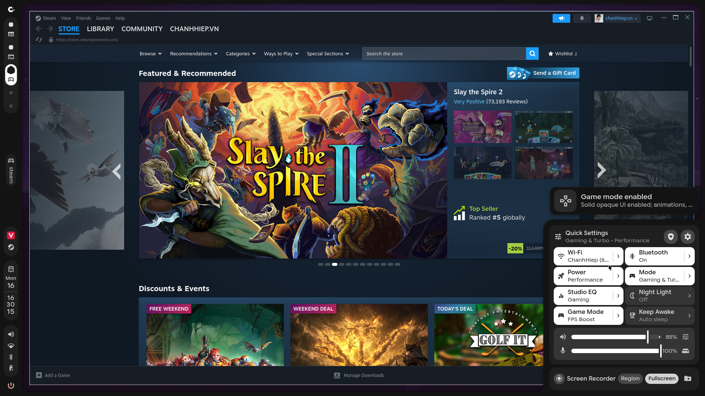
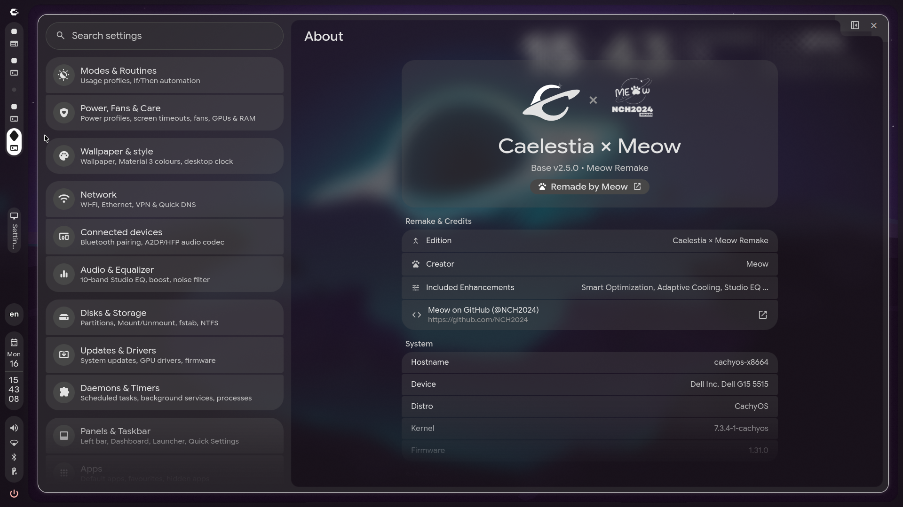

<div align="center">

<picture>
  <source media="(prefers-color-scheme: dark)" srcset="assets/logo-dark.png" />
  <source media="(prefers-color-scheme: light)" srcset="assets/logo-light.png" />
  
</picture>

# Caelestia × Meow Remake

**A Material 3 Wayland Desktop (`Hyprland` + `Quickshell`) with One-Click Optimization, Adaptive Cooling, Seamless System & Driver Updates, Modes & Routines, and a 10-Band Studio Equalizer.**

[](https://hyprland.org/)
[](https://quickshell.outfoxxed.me/)
[](https://cachyos.org/)
[-FF79C6?style=flat-square&logo=github&logoColor=white)](https://github.com/NCH2024)

</div>

---

## Highlights & New Features

- **Top-Hover Smart Optimization Tab** (right before **Weather**)
  - Clean, beginner-friendly layout: **PC Health Ring**, **Boost & Clean Now**, and **3-tap Performance Presets** (**Quiet**, **Everyday**, **Max Speed**) plus a **Max Fan Cooling** toggle.
  - Real staged cleanup underneath (`caelestia-optimize`): drops page cache, compacts RAM, cleans orphaned `pacman` download folders & old `paccache` versions, vacuums `journald`, resets failed systemd units, and runs NVMe `fstrim`.
- **Anti-Heat Balanced Tuning & Adaptive Fan Curve**
  - Eliminates hot idle laptop behavior (`balance_performance` 4 GHz spikes with `0 RPM` fans) using `balance_power` EPP + `80%` frequency cap and a whisper-quiet fan hysteresis (`≥ 61°C` gentle airflow, `≤ 53°C` silent auto).
  - Configures iGPU-first Wayland compositing (`AQ_DRM_DEVICES`) and avoids waking sleeping NVIDIA dGPUs during telemetry polling.
- **Seamless System Updates & Hardware Drivers (`Updates & Drivers`)**
  - Unified GUI for **Official (`pacman`)**, **AUR (`paru`/`yay`)**, and **Flatpak** updates with non-blocking progress bars (`pkexec`) and expandable terminal output on click.
  - Detects installed/recommended GPU & CPU microcode drivers (`chwd -a`), checks UEFI/device firmware (`fwupdmgr`), ranks CachyOS mirrors, and cleans orphan packages.
- **Modes & Automated If/Then Routines (`Modes & Routines`)**
  - Built-in usage profiles (**Balanced**, **Gaming & Turbo**, **Work & Focus**, **Developer**, **Cinema & Media**, **Night & Battery Saver**) that synchronize Power, Cooling, Equalizer, Game Mode, DND, and Night Light.
  - **Adaptive Solid UI:** Entering **Game Mode** or **Battery Saver** automatically switches panels to a crisp opaque surface (disabling blur and transparency) and restores your glass theme when switching back.
  - **Smart Lifecycle & App Monitor:** Tracks open Hyprland windows (ignoring minimized tray background processes like Steam tray), auto-restores your previous mode when the app/window closes, and respects manual mode overrides until the app restarts.
- **10-Band PipeWire Studio Equalizer (`Audio & Studio Equalizer`)**
  - Runs stably as a user `systemd-run` PipeWire filter chain (`caelestia-eq.service`) with 10 presets (*Cinema Surround*, *Bass Boost*, *Rock*, *Vocal*, *Gaming*, etc.), volume overdrive (`up to 150%`), channel balance, and mic noise cancellation.
- **Complete System Control Center (`Nexus`)**
  - **CachyOS `sched-ext` & Kernel Tuning:** Switch live between `EEVDF`, `scx_lavd`, `scx_bpfland`, `scx_cosmos`, and `scx_rusty`, NVMe I/O scheduler, CPU Turbo Boost, and Auto-RAM Guard.
  - **Daemons, Timers & Disks:** Manage background systemd services, scheduled timers, top memory processes, partitions/`fstab`, Quick DNS (`1.1.1.1`, `8.8.8.8`, AdGuard), and Bluetooth codecs.
  - **Unified Branding & Login:** Matching Caelestia **SDDM theme**, hang-free logout (`hyprctl dispatch exit`), and **Caelestia × Meow** About page.

---

## Screenshots

### Desktop Overview
Clean Material 3 desktop with left vertical taskbar, audio spectrum visualizer, and clock/weather widget.


---

### Top-Hover Smart Optimization Tab
Located right before **Weather** — shows PC health score, 1-click **Boost & Clean Now**, **Quiet / Everyday / Max Speed** presets, **Max Fan Cooling**, and **Automatic Care**.


---

### Power, Fans & Device Care
Full control over CachyOS `scx_loader` schedulers, CPU Turbo Boost, NVMe I/O scheduler, Auto-Boost RAM Guard, Smart Cool Balanced Tuning, and manual fan curves.


---

### Updates & Hardware Drivers
Check Official, AUR, and Flatpak updates with live progress bars, recommended GPU/microcode drivers (`chwd`), UEFI firmware (`fwupdmgr`), and mirror/orphan cleanup.


---

### Modes & Automated Routines
One-click system profiles (**Balanced**, **Gaming & Turbo**, **Work & Focus**, **Developer**, **Cinema & Media**, **Night & Battery Saver**) plus If/Then routines triggered by schedule, running app, or Wi-Fi.


---

### Live Auto-Trigger Demo: Steam → Automatic Gaming Boost
When **Steam** (or `gamescope` / `cs2` / `dota2`) launches on any workspace (e.g. Workspace 3), the enabled **If/Then Process Routine** automatically activates **Gaming & Turbo** and **Max Speed** — and switches panels to a **solid, opaque, zero-blur Material 3 surface** so overlays stay crisp and readable over any game or bright store art.


---

### Quick Settings & System Controls
Instant bottom-right control drawer synchronized 1:1 with Modes, Power Profiles, Studio EQ presets, Game Mode (`FPS Boost`), Keep Awake, Night Light, audio sliders, and Screen Recorder.



---

### 10-Band Studio Equalizer
PipeWire 10-band DSP filter chain (`caelestia-eq.service`) with 10 instant presets, Bass/Treble boost, volume overdrive up to `150%`, channel balance, and mic noise cancellation.


---

### About (Caelestia × Meow)
Co-branded **Caelestia × Meow** hero card with adaptive Material 3 logo tinting and live system hardware readout.



---

## Prerequisites (Arch / CachyOS)

```bash
sudo pacman -S --needed \
  hyprland quickshell-git caelestia-cli \
  power-profiles-daemon pipewire wireplumber \
  ananicy-cpp pacman-contrib bluez networkmanager \
  sddm qt6-5compat grim

# Optional: CachyOS sched-ext CPU schedulers (LAVD, Bpfland, Cosmos, Rusty)
sudo pacman -S --needed scx-scheds scx-tools
```

> On standard Arch/EndeavourOS, install `quickshell-git` and `caelestia-cli` via AUR (`paru -S quickshell-git caelestia-cli`).

---

## Installation

`install.sh` automatically backs up any existing configs (`*.bak-YYYYMMDD-HHMMSS`) before installing.

```bash
git clone https://github.com/NCH2024/Caelestia-NCH2024.git
cd Caelestia-NCH2024
chmod +x install.sh bin/*

# Option A: User configs + hardware helpers only
./install.sh

# Option B: Recommended (adds matching SDDM login theme + passwordless Polkit actions)
./install.sh --with-sddm --with-polkit

# Option C: Full automated setup including pacman dependencies
./install.sh --all
```

Reload the shell after installation:

```bash
pkill -x qs; caelestia shell -d
```

---

## Adapting to Different Hardware

Tuned on a **Dell G15 5515 (`AMD Ryzen 5 5600H` + `NVIDIA RTX 3050` + `NVMe`)** running CachyOS. Most sensors auto-detect automatically — check these items if your hardware differs:

### 1. GPU Setup
- **Hybrid Laptops (AMD/Intel iGPU + NVIDIA dGPU):** `install.sh` auto-detects `/dev/dri/by-path/*-card` and writes `AQ_DRM_DEVICES` to `~/.config/hypr/hyprland/env.lua` so Hyprland composites on the iGPU while allowing the dGPU to sleep.
- **AMD-only or Intel-only:** `install.sh` sets `"gpuType": "None"` in `~/.config/caelestia/shell.json`. You can set `"Amd"` for AMD monitoring.
- **NVIDIA Desktop (Single GPU):** Remove any `AQ_DRM_DEVICES` line in `env.lua` and add `GBM_BACKEND=nvidia-drm` / `__GLX_VENDOR_LIBRARY_NAME=nvidia` if needed.

### 2. CPU & Kernel Schedulers
- **Sensors:** `caelestia-telemetry` auto-detects `k10temp` / `zenpower` (AMD), `coretemp` (Intel), and `acpitz`.
- **Balanced Cap:** If `80%` max frequency in **Cool & quiet balanced tuning** feels conservative on older Intel CPUs, toggle it off directly in the **Optimization** tab.
- **No `scx-scheds`:** If `scxctl` is absent or kernel `< 6.12`, CPU scheduling cleanly falls back to standard Linux **EEVDF**.

### 3. Laptop Fan Control
- **Dell (`dell_smm` + `alienware_wmi`):** Full adaptive Balanced cooling (`auto-cool`) and manual CPU/GPU % sliders work out of the box.
- **ThinkPad (`thinkpad_hwmon`):** Fan RPM telemetry works automatically (manual fan speed requires `options thinkpad_acpi fan_control=1`).
- **ASUS / Lenovo / Desktop:** `Quiet / Everyday / Max Speed` profiles work via `power-profiles-daemon`; Dell-specific PWM controls safely no-op.

### 4. Monitors, Weather & Polkit
- **Display Scale / Refresh Rate:** Configure inside **Nexus Settings → Panels / Display** or `~/.config/hypr/hyprland/rules.lua`.
- **Weather Location:** Set `"weatherLocation": "<lat>,<lon>"` in `~/.config/caelestia/shell.json` or via **Nexus Settings → Language & region**.
- **Passwordless Actions:** Omit `--with-polkit` during install (or remove `/etc/polkit-1/rules.d/10-caelestia.rules`) if you prefer password prompts on optimization/updates.

---

## Troubleshooting & IPC Shortcuts

```bash
# Live shell logs
caelestia shell -l

# Open drawers or Nexus pages directly via CLI / keybinds
qs -c caelestia ipc call drawers openDashboardTab 3   # Top Optimization Tab
qs -c caelestia ipc call nexus openPage 0            # Modes & Routines
qs -c caelestia ipc call nexus openPage 1            # Power, Fans & Care
qs -c caelestia ipc call nexus openPage 5            # Audio & Studio Equalizer
qs -c caelestia ipc call nexus openPage 7            # Updates & Drivers
qs -c caelestia ipc call nexus openPage 13           # About (Caelestia × Meow)

# Uninstall system helpers
./uninstall.sh
```

---

<div align="center">
  Remade by <b>Meow</b> (<a href="https://github.com/NCH2024">@NCH2024</a>) • Built on <b>Caelestia Shell</b>
</div>
