<div align="center">

<picture>
  <source media="(prefers-color-scheme: dark)" srcset="assets/logo-dark.png" />
  <source media="(prefers-color-scheme: light)" srcset="assets/logo-light.png" />
  
</picture>

# Caelestia × Meow Remake

**A Next-Gen Material 3 Wayland Desktop (`Hyprland` + `Quickshell`) Powered by *Meow AI*: Real-Time Multi-Cursor GUI Automation, Human-Like Web Research & LibreOffice Word Curation, 10-Band Studio EQ, Adaptive Cooling, and Apple-Style Liquid Glass.**

[](https://hyprland.org/)
[](https://quickshell.outfoxxed.me/)
[](https://antigravity.google/)
[](https://cachyos.org/)
[-FF79C6?style=flat-square&logo=github&logoColor=white)](https://github.com/NCH2024)

</div>

---

## ✨ Flagship Feature: *Meow AI* Autonomous Desktop Control (`SUPER + >`)

> **Not just a chatbot — *Meow AI* sees your screen, moves multiple color-coded 120Hz cursors in real time, reads & curates articles cleanly into LibreOffice Writer, plays YouTube with hardware audio verification, and controls system modes instantaneously.**

<div align="center">

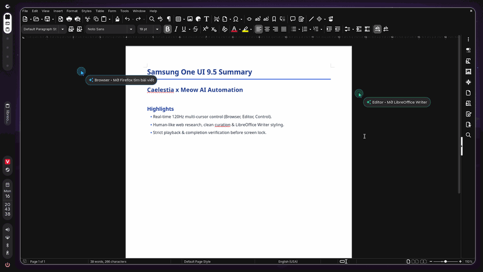

*Live animated demo: **Browser** (Cyan), **Editor** (Emerald), and **Control** (Amber) Ghost Cursors coordinating across Firefox, styled LibreOffice Writer `.docx`, and System Modes simultaneously.*

</div>

### Why *Meow AI* Is Different
- **🎯 120Hz Multi-Cursor Ghost Overlay (`AiCursorOverlay`):** Up to 4 simultaneous color-coded AI pointers (`Browser`, `Editor`, `Control`, `Research`) with persistent task-lifetime tracking, breathing idle states, click ripples, and smooth `420ms` fade-out transitions.
- **🌐 Human-Like Web → Curated LibreOffice Word Pipeline:** Opens Firefox visibly, skips search widget clutter, scrolls real articles, uses AI curation to strip website menus/ads into clean bilingual sections, writes **styled `.docx` documents** (`Noto Sans`, accent blue headings, underline rules, bullet lists), and opens them natively in **LibreOffice Writer** (`Flatpak` & native) / **LinOffice**.
- **🎵 Race-Free Visual YouTube & Hard OS Verification Gates:** `caelestia-desktop yt-play` uses sub-second inverted-gray OCR (`0.89s`, accent-insensitive Vietnamese+English), skips browser headers (`--min-y 185`), waits cleanly for natural autoplay, and verifies active audio via PipeWire (`pactl list sink-inputs` → `Corked: no`) — **refusing** to lock the screen or report success if playback didn't start.
- **⚡ Hybrid 4-Tier Speed Router:** Instant CLI/IPC (`< 0.2s`) for system modes, brightness, volume & lock barriers; curated multi-track execution (`~15–27s`) for complex workflows; and adaptive multi-agent collaboration for deep coding tasks.
- **🧠 Preloaded Host Awareness & Failover:** Automatically maps your machine into `~/AGENTS.md` (`build_system_map.py`), puts **AI Automation** at **#1 in Nexus Settings**, remembers per-model `429` cooldown timers (`ai_model_cooldowns.json`), and auto-rotates fallback models without stalling.
- **⌨️ `SUPER + >` Quick Launcher & Mini Progress HUD:** Dispatch commands anywhere via `SUPER + >` (`>ai <command>`) with full `fcitx5` Vietnamese typing, compact floating status pill, and 7–180 day chat/log history retention.

---

## Highlights & New Features

- **Top-Hover Smart Optimization Tab** (right before **Weather**)
  - Clean, beginner-friendly layout: **PC Health Ring**, **Boost & Clean Now**, and **3-tap Performance Presets** (**Quiet**, **Everyday**, **Max Speed**) plus a **Max Fan Cooling** toggle.
  - Real staged cleanup underneath (`caelestia-optimize`): drops page cache, compacts RAM, cleans orphaned `pacman` download folders & old `paccache` versions, vacuums `journald`, resets failed systemd units, and runs NVMe `fstrim`.
- **Anti-Heat Balanced Tuning & Adaptive Fan Curve**
  - Eliminates hot idle laptop behavior (`balance_performance` 4 GHz spikes with `0 RPM` fans) using `balance_power` EPP + `80%` frequency cap and a whisper-quiet fan hysteresis (`≥ 61°C` gentle airflow, `≤ 53°C` silent auto).
  - Configures iGPU-first Wayland compositing (`AQ_DRM_DEVICES`) and avoids waking sleeping NVIDIA dGPUs during telemetry polling.
- **Seamless System Updates & Hardware Drivers (`Updates & Drivers`)**
  - Unified GUI for **Official (`pacman`)**, **AUR (`paru`/`yay`)**, and **Flatpak** updates with non-blocking progress bars (`pkexec`) and expandable terminal output on click.
  - Detects installed/recommended GPU & CPU microcode drivers (`chwd -a`), checks UEFI/device firmware (`fwupdmgr`), ranks CachyOS mirrors, and cleans orphan packages.
- **Modes & Automated If/Then Routines (`Modes & Routines`)**
  - Built-in usage profiles (**Balanced**, **Gaming & Turbo**, **Work & Focus**, **Developer**, **Cinema & Media**, **Night & Battery Saver**) that synchronize Power, Cooling, Equalizer, Game Mode, DND, and Night Light.
  - **Adaptive Solid UI:** Entering **Game Mode** or **Battery Saver** automatically switches panels to a crisp opaque surface (disabling blur and transparency) and restores your glass theme when switching back.
  - **Smart Lifecycle & App Monitor:** Tracks open Hyprland windows (ignoring minimized tray background processes like Steam tray), auto-restores your previous mode when the app/window closes, and respects manual mode overrides until the app restarts.
- **10-Band PipeWire Studio Equalizer (`Audio & Studio Equalizer`)**
  - Runs stably as a user `systemd-run` PipeWire filter chain (`caelestia-eq.service`) with 10 presets (*Cinema Surround*, *Bass Boost*, *Rock*, *Vocal*, *Gaming*, etc.), volume overdrive (`up to 150%`), channel balance, and mic noise cancellation.
- **Complete System Control Center (`Nexus`)**
  - **CachyOS `sched-ext` & Kernel Tuning:** Switch live between `EEVDF`, `scx_lavd`, `scx_bpfland`, `scx_cosmos`, and `scx_rusty`, NVMe I/O scheduler, CPU Turbo Boost, and Auto-RAM Guard.
  - **Daemons, Timers & Disks:** Manage background systemd services, scheduled timers, top memory processes, partitions/`fstab`, Quick DNS (`1.1.1.1`, `8.8.8.8`, AdGuard), and Bluetooth codecs.
  - **Unified Branding & Login:** Matching Caelestia **SDDM theme**, hang-free logout (`hyprctl dispatch exit`), and **Caelestia × Meow** About page.
- **Keybinds & Shortcuts Manager (`Keybinds & Shortcuts`):**
  - Searchable overview of all active Hyprland & shell shortcuts plus a visual builder to bind custom hotkeys to **System Modes** (`SUPER + ALT + M` cycle mode, `SUPER + ALT + G` Gaming toggle), UI panels (`SUPER + ALT + O` Optimization, `SUPER + ALT + K` Keybinds), or custom commands (`hypr-user.lua` + live `hyprctl reload`).
- **Right-Edge Mode Switch OSD:**
  - Switching modes via hotkey or routine displays a crisp edge OSD pill right above the Volume/Brightness sliders (`WlrLayer.Overlay` — floats cleanly over normal and fullscreen windows).
- **Apple-Style Liquid Glass (`Wallpaper & style`):**
  - Compiled Qt6 GLSL Fresnel optical shader (`liquid_glass.frag.qsb`) applied globally across `StyledRect` cards and panels, paired with Hyprland multi-pass vibrancy blur (`size 16`, `passes 4`, `vibrancy 0.36`) for subtle curved specular rims and crystal-clear glass depth (automatically disabled for 0% overhead in Game Mode / Battery Saver).
- **AI Task Automation (`AI Automation` + `SUPER + >`):**
  - Deep **Antigravity CLI (`agy`)** integration in Nexus Settings: detects installation & login state (`agy`), lists all discovered models dynamically, supports **Chat Language selection** (`Tiếng Việt`, `English`, `Auto`), and enables **automatic quota/rate-limit model failover**.
  - **Coordinator & Execution Engine (`Meow AI`):** Uses an adaptive router (`Tier 0` local fast-path, `direct` Q&A, `single` cached unified agent, and `multi` parallel 2–3 track specialists). Preloads host context cleanly via `~/AGENTS.md` (`build_system_map.py`) and operates browsers/desktop apps in real time with **Multi-Cursor Visual GUI Automation** (`caelestia-desktop` `find` / `click-text` via Tesseract OCR, `fcntl`-locked `1px`-calibrated `ydotool`, UTF-8 typing, and up to 4 concurrent color-coded Ghost Cursors).
  - **Persistent Quota Cooldown Cache:** Tracks per-model `429` reset timers (`ai_model_cooldowns.json`) and displays live `Ready` / `Cooldown` badges in Nexus so exhausted models are skipped automatically with zero retry storms.
  - **Persistent Chat History & Log Retention:** Automatically saves conversations (`~/.local/share/caelestia/ai/history.json`) and raw execution logs (`logs/*.log`) with an in-chat **History** browser (`restore chat` / `view log` / `delete`) and configurable auto-cleanup from **7 days (1 week) up to 180 days (6 months)** or manual one-click wipe in Nexus Settings.
  - **Quick Launch (`SUPER + >` / `>ai <command>`):** Jumps straight into AI prompt entry inside the Caelestia Launcher (every new request starts a fresh chat automatically).

---

## Screenshots

### Desktop Overview
Clean Material 3 desktop with left vertical taskbar, audio spectrum visualizer, and clock/weather widget.

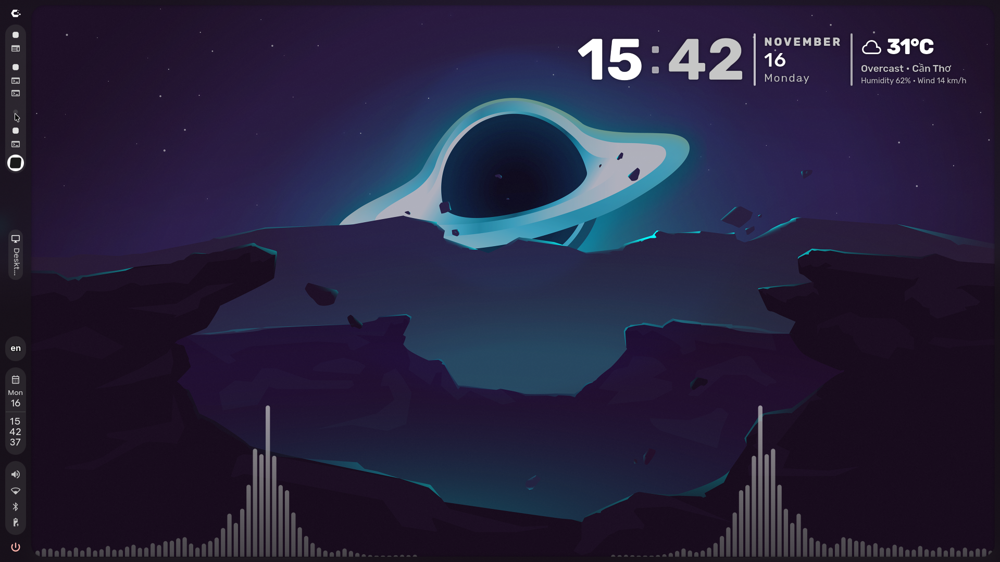

---

### Top-Hover Smart Optimization Tab
Located right before **Weather** — shows PC health score, 1-click **Boost & Clean Now**, **Quiet / Everyday / Max Speed** presets, **Max Fan Cooling**, and **Automatic Care**.


---

### Power, Fans & Device Care
Full control over CachyOS `scx_loader` schedulers, CPU Turbo Boost, NVMe I/O scheduler, Auto-Boost RAM Guard, Smart Cool Balanced Tuning, and manual fan curves.


---

### Updates & Hardware Drivers
Check Official, AUR, and Flatpak updates with live progress bars, recommended GPU/microcode drivers (`chwd`), UEFI firmware (`fwupdmgr`), and mirror/orphan cleanup.

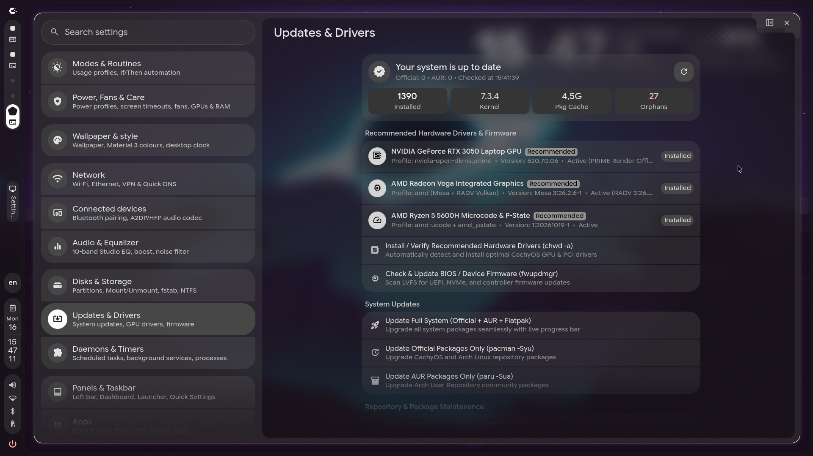

---

### Modes & Automated Routines
One-click system profiles (**Balanced**, **Gaming & Turbo**, **Work & Focus**, **Developer**, **Cinema & Media**, **Night & Battery Saver**) plus If/Then routines triggered by schedule, running app, or Wi-Fi.

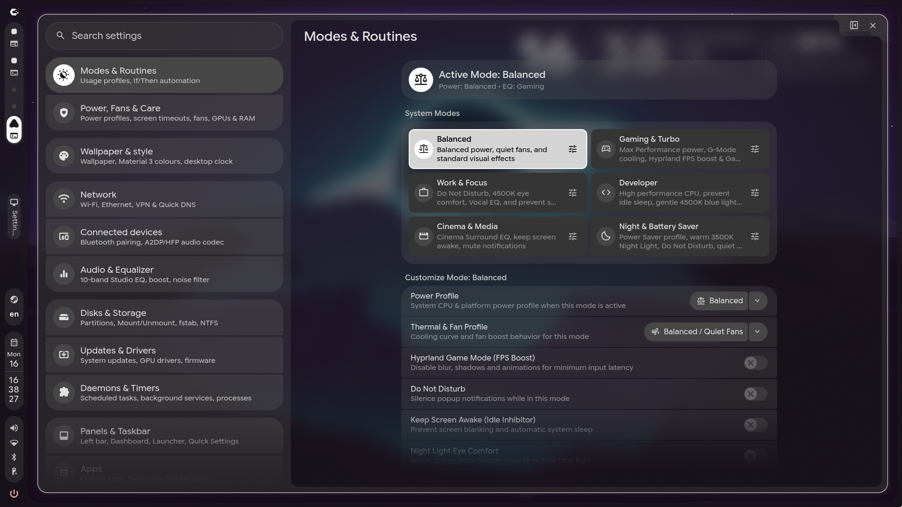

---

### Live Auto-Trigger Demo: Steam → Automatic Gaming Boost
When **Steam** (or `gamescope` / `cs2` / `dota2`) launches on any workspace (e.g. Workspace 3), the enabled **If/Then Process Routine** automatically activates **Gaming & Turbo** and **Max Speed** — and switches panels to a **solid, opaque, zero-blur Material 3 surface** so overlays stay crisp and readable over any game or bright store art.

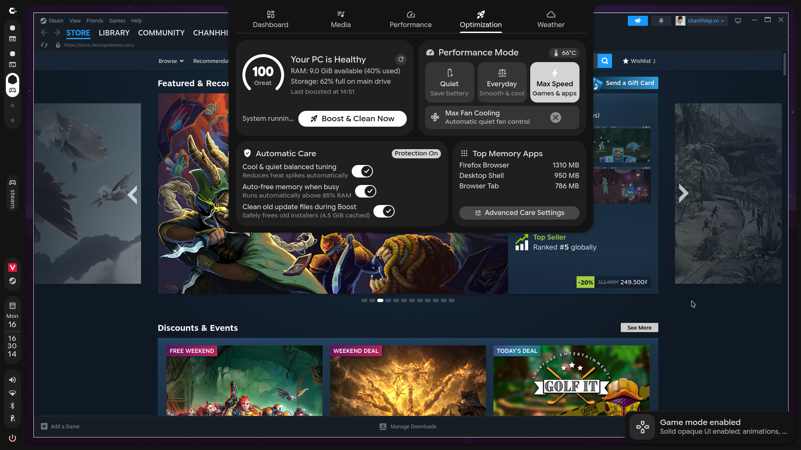

---

### Quick Settings & System Controls
Instant bottom-right control drawer synchronized 1:1 with Modes, Power Profiles, Studio EQ presets, Game Mode (`FPS Boost`), Keep Awake, Night Light, audio sliders, and Screen Recorder.


---

### Apple-Style Liquid Glass (Global Optical Rim & Vibrancy)
Optional macOS-inspired optical glass mode (`Wallpaper & style → Liquid Glass`) using a global compiled Qt6 GLSL shader (`liquid_glass.frag.qsb`) on rounded cards and surfaces for curved directional specular rims and deep frosted backdrop vibrancy blur.

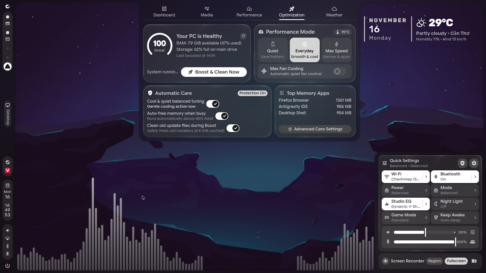

---

### Edge Mode Switch OSD (Overrides Fullscreen)
Switching modes via keyboard shortcuts (`SUPER + ALT + M` / `SUPER + ALT + G`) or routines shows a slim vertical Mode Pill right at the Volume & Brightness edge bar (`WlrLayer.Overlay` over normal & fullscreen windows).

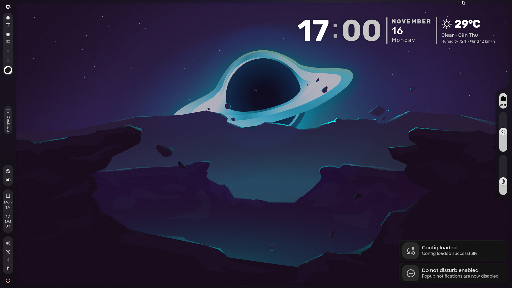

---

### Keybinds & Shortcuts Manager
Search all active Hyprland hotkeys or visually create custom shortcuts mapped to System Modes, panels, or shell commands (`hypr-user.lua`).

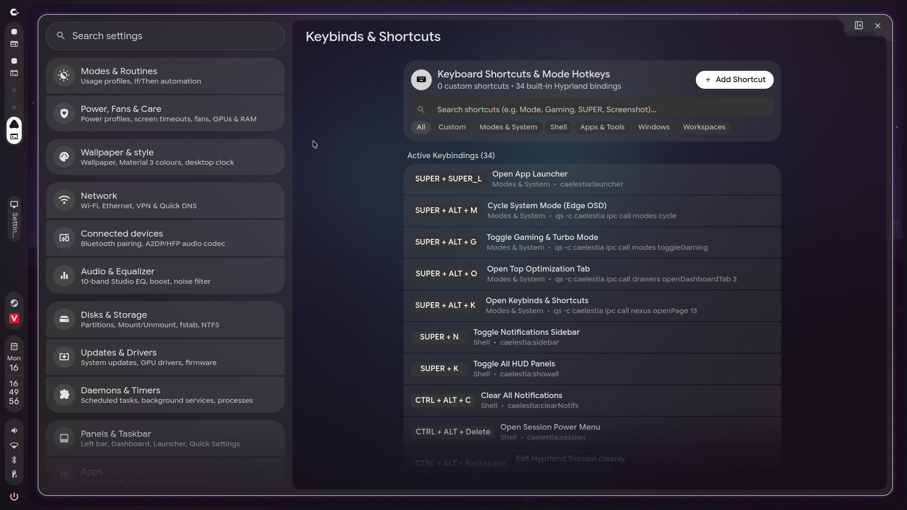

---

### AI Automation Settings (`#1 Top Tab` — `Antigravity CLI`, Language & Failover)
Pinned right at the **top of Nexus Settings (`openPage 0`)**: inspect `agy` installation & login state, switch **AI Chat & Response Language** (`Tiếng Việt` / `English` / `Auto`), scan all 18+ models, configure Coordinator & Execution models, customize quota-exhaustion fallback priority, and manage history/log retention.

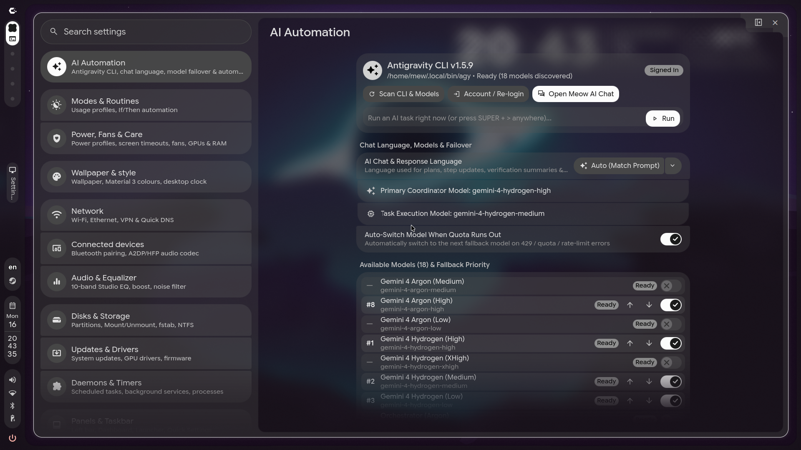

---

### Quick AI Task Prompt (`SUPER + >` / `>ai <command>`)
Press **`SUPER + >`** (or type `>ai <command>` in the Launcher with full `fcitx5` Vietnamese input support) to dispatch **Meow AI** directly from anywhere.

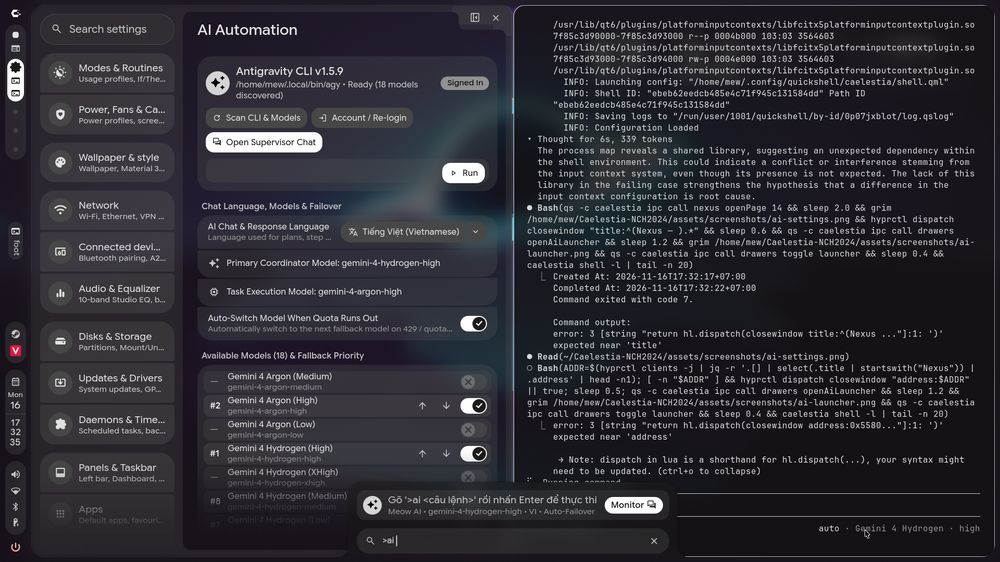

---

### Meow AI Multi-Cursor GUI Automation & Mini HUD (`SUPER + >`)
Invoking a task via **`SUPER + >`** (`>ai <command>`) shows a sleek compact **Mini Progress Popup** directly above the launcher area while parallel AI workers control separate apps visually with independent color-coded **120Hz Ghost Cursors** (e.g., Cyan `Browser` + Amber `Control`), click ripples, and sub-second OCR targeting (`caelestia-desktop click-text`).

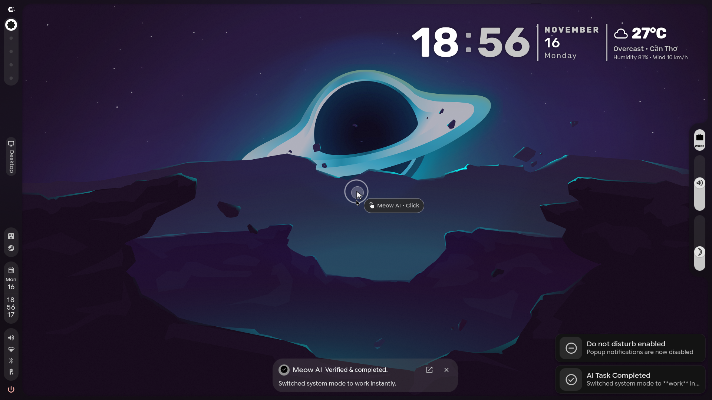

---

### Meow AI Assistant (Full Rich-Markdown Chat & History)
Floating **Meow AI Assistant** chat window with Liquid Glass optical rims, live inline execution steps & progress bar (no popup terminal clutter by default), Vietnamese/English localization, automatic chat refresh per new request, and interactive confirmation prompts when intervention is needed.

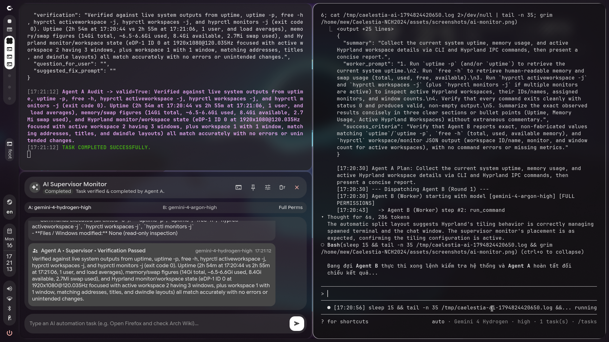

---

### 10-Band Studio Equalizer
PipeWire 10-band DSP filter chain (`caelestia-eq.service`) with 10 instant presets, Bass/Treble boost, volume overdrive up to `150%`, channel balance, and mic noise cancellation.


---

### About (Caelestia × Meow)
Co-branded **Caelestia × Meow** hero card with adaptive Material 3 logo tinting and live system hardware readout.


---

## Prerequisites (Arch / CachyOS)

```bash
sudo pacman -S --needed \
  hyprland quickshell-git caelestia-cli \
  power-profiles-daemon pipewire wireplumber \
  ananicy-cpp pacman-contrib bluez networkmanager \
  sddm qt6-5compat grim foot ydotool curl noto-fonts \
  python python-pillow tesseract tesseract-data-eng tesseract-data-vie wl-clipboard

# Optional: CachyOS sched-ext CPU schedulers (LAVD, Bpfland, Cosmos, Rusty)
sudo pacman -S --needed scx-scheds scx-tools
```

> On standard Arch/EndeavourOS, install `quickshell-git` and `caelestia-cli` via AUR (`paru -S quickshell-git caelestia-cli`). Precompiled `.frag.qsb` shader binaries are included; `qt6-shadertools` (`qsb`) is only needed if you modify `assets/shaders/liquid_glass.frag`.

---

## Installation

`install.sh` automatically backs up any existing configs (`*.bak-YYYYMMDD-HHMMSS`) before installing.

```bash
git clone https://github.com/NCH2024/Caelestia-NCH2024.git
cd Caelestia-NCH2024
chmod +x install.sh bin/*

# Option A: User configs + hardware helpers only
./install.sh

# Option B: Recommended (adds matching SDDM login theme + passwordless Polkit actions)
./install.sh --with-sddm --with-polkit

# Option C: Full automated setup including pacman dependencies
./install.sh --all
```

Reload the shell after installation:

```bash
pkill -x qs; caelestia shell -d
```

---

## Adapting to Different Hardware

Tuned on a **Dell G15 5515 (`AMD Ryzen 5 5600H` + `NVIDIA RTX 3050` + `NVMe`)** running CachyOS. Most sensors auto-detect automatically — check these items if your hardware differs:

### 1. GPU Setup
- **Hybrid Laptops (AMD/Intel iGPU + NVIDIA dGPU):** `install.sh` auto-detects `/dev/dri/by-path/*-card` and writes `AQ_DRM_DEVICES` to `~/.config/hypr/hyprland/env.lua` so Hyprland composites on the iGPU while allowing the dGPU to sleep.
- **AMD-only or Intel-only:** `install.sh` sets `"gpuType": "None"` in `~/.config/caelestia/shell.json`. You can set `"Amd"` for AMD monitoring.
- **NVIDIA Desktop (Single GPU):** Remove any `AQ_DRM_DEVICES` line in `env.lua` and add `GBM_BACKEND=nvidia-drm` / `__GLX_VENDOR_LIBRARY_NAME=nvidia` if needed.

### 2. CPU & Kernel Schedulers
- **Sensors:** `caelestia-telemetry` auto-detects `k10temp` / `zenpower` (AMD), `coretemp` (Intel), and `acpitz`.
- **Balanced Cap:** If `80%` max frequency in **Cool & quiet balanced tuning** feels conservative on older Intel CPUs, toggle it off directly in the **Optimization** tab.
- **No `scx-scheds`:** If `scxctl` is absent or kernel `< 6.12`, CPU scheduling cleanly falls back to standard Linux **EEVDF**.

### 3. Laptop Fan Control
- **Dell (`dell_smm` + `alienware_wmi`):** Full adaptive Balanced cooling (`auto-cool`) and manual CPU/GPU % sliders work out of the box.
- **ThinkPad (`thinkpad_hwmon`):** Fan RPM telemetry works automatically (manual fan speed requires `options thinkpad_acpi fan_control=1`).
- **ASUS / Lenovo / Desktop:** `Quiet / Everyday / Max Speed` profiles work via `power-profiles-daemon`; Dell-specific PWM controls safely no-op.

### 4. Monitors, Weather & Polkit
- **Display Scale / Refresh Rate:** Configure inside **Nexus Settings → Panels / Display** or `~/.config/hypr/hyprland/rules.lua`.
- **Weather Location:** Set `"weatherLocation": "<lat>,<lon>"` in `~/.config/caelestia/shell.json` or via **Nexus Settings → Language & region**.
- **Passwordless Actions:** Omit `--with-polkit` during install (or remove `/etc/polkit-1/rules.d/10-caelestia.rules`) if you prefer password prompts on optimization/updates.

---

## Troubleshooting & IPC Shortcuts

```bash
# Live shell logs
caelestia shell -l

# Open drawers or Nexus pages directly via CLI / keybinds
qs -c caelestia ipc call modes cycle                  # Cycle Modes (with Edge OSD)
qs -c caelestia ipc call modes toggleGaming           # Toggle Gaming & Turbo (with Edge OSD)
qs -c caelestia ipc call modes setLiquidGlass true    # Enable Liquid Glass & Water Optics
qs -c caelestia ipc call drawers openDashboardTab 3   # Top Optimization Tab
qs -c caelestia ipc call nexus openPage 0            # AI Automation (Top Settings Tab)
qs -c caelestia ipc call nexus openPage 1            # Modes & Routines
qs -c caelestia ipc call nexus openPage 2            # Power, Fans & Care
qs -c caelestia ipc call nexus openPage 6            # Audio & Studio Equalizer
qs -c caelestia ipc call nexus openPage 8            # Updates & Drivers
qs -c caelestia ipc call nexus openPage 14           # Keybinds & Shortcuts
qs -c caelestia ipc call nexus openPage 15           # About (Caelestia × Meow)
qs -c caelestia ipc call drawers openAiLauncher      # Quick Launch AI Prompt (SUPER + >)
qs -c caelestia ipc call ai openMonitor              # Open AI Supervisor Chat Monitor

# Uninstall system helpers
./uninstall.sh
```

---

<div align="center">
  Remade by <b>Meow</b> (<a href="https://github.com/NCH2024">@NCH2024</a>) • Built on <b>Caelestia Shell</b>
</div>
